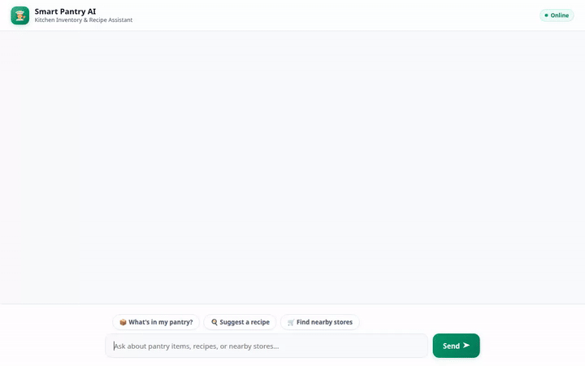

# Smart Pantry AI 🥦🍳

Smart Pantry AI is an intelligent kitchen, inventory, and meal-planning assistant built with Google Agent Development Kit (ADK), Vertex AI, and Google Cloud platform services. It tracks pantry ingredients in real time, respects user dietary restrictions and memory preferences across sessions, recommends personalized recipes, generates food photography and videos, and renders interactive UI components on the fly.



---

## 🌟 Implemented Features & Architecture

### 1. 📦 Real-Time Pantry Inventory (Google Cloud Firestore)
- **`get_pantry_items`**: Retrieves live inventory items, quantities, and units stored in Google Cloud Firestore (`pantry` collection).
- **`add_pantry_item`**: Adds new items directly to the Firestore database.
- **`update_pantry_quantity`**: Updates ingredient quantities in Firestore.

### 2. 🧠 Persistent Memory & Dietary Safety (Vertex AI Memory Bank)
- **`PreloadMemoryTool` & Memory Bank Integration**: Persists user allergies, dietary restrictions (e.g. gluten-free, peanut allergy, vegan), and kitchen preferences across conversation sessions via **Vertex AI Memory Bank**.
- **Automated Memory Session Extractors**: Automatically ingests session history post-turn to ensure future recipe recommendations strictly avoid stored allergens.

### 3. 🖼️ Food Photography Generation (Vertex AI Imagen 3)
- **`generate_dish_image`**: Generates high-resolution food photography for suggested dishes using Vertex AI Imagen 3 (`gemini-3.1-flash-lite-image`).
- **Cloud Storage Integration**: Automatically uploads generated image bytes in-memory to a public **Google Cloud Storage** bucket (`smart-pantry-media-*`) and returns direct HTTPS media URLs.

### 4. 🎥 Dish Video Generation (Vertex AI Gemini Omni Model)
- **`generate_dish_video`**: Generates short looping video clips of dishes using Google's Omni model (`gemini-omni-flash-preview`) called via the Vertex AI Interactions API in the `global` region.
- **Artifact & Cloud Storage Persistence**: Saves video parts to the ADK Playground Artifacts panel while uploading in-memory video bytes to Google Cloud Storage.

### 5. 🎨 Interactive Dynamic UI (A2UI Surface Protocol)
- **A2UI Schema Manager & Callbacks**: Renders structured data (pantry stock lists, recipe cards, and dish previews) directly into native A2UI JSON surfaces (Card, Column, Row, Text, Image) on the frontend.

### 6. 📍 Local Grocery & Recipe Search
- **`search_recipes` & `search_online_recipes`**: Recommends recipes using available pantry items or queries online culinary databases.
- **`geocode_address` & `find_nearby_places`**: Geocodes locations and locates nearby markets and grocery stores.

### 7. 🐍 Agent Engine Code Sandbox Execution
- **`AgentEngineSandboxCodeExecutor`**: Executes Python code safely inside Google Cloud Agent Engine Sandbox for mathematical conversions, scaling recipes, or complex calculations.

---

## 📋 Status of Planned Features

- **Implemented**: Firestore inventory sync, Memory Bank persistence, Imagen 3 photo generation, Gemini Omni video generation, A2UI UI rendering, Geocoding & Places search, Code execution.
- **Planned / Future Enhancements**: Automatic barcode scanning via camera input, supermarket price comparisons, meal-prep calendar sync.

---

## 🛠️ Local Setup and Run Instructions

### Prerequisites
- Python 3.10+
- Google Cloud CLI authenticated with access to Vertex AI, Firestore, and Cloud Storage.

### 1. Install Dependencies
```bash
pip install -r requirements.txt
```

### 2. Configure Environment Variables
Set your Agent Engine resource name and agent directory:
```bash
export AGENT_ENGINE_RESOURCE_NAME="projects/<PROJECT_NUMBER>/locations/<LOCATION>/reasoningEngines/<REASONING_ENGINE_ID>"
export AGENT_DIRECTORY="app"
```

### 3. Launch the Local Development Server
```bash
python main.py
```
The server will start locally (default port `8080`). Open your web browser to the local address output by the command to interact with the Smart Pantry AI agent and UI.
